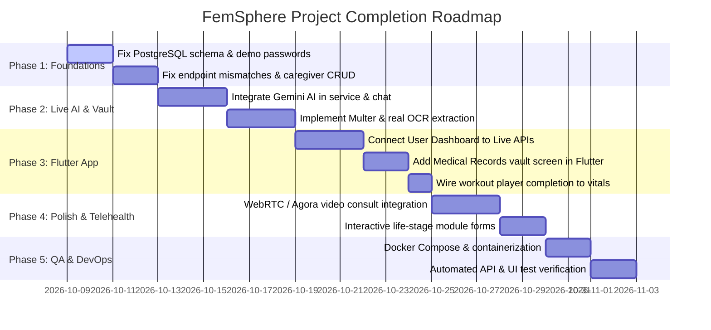

# 🌸 FemSphere — Master Project Completion Roadmap (`todo.md`)

> **Comprehensive, prioritized action plan to take FemSphere from its current hybrid prototype state to a robust, production-ready, college-submission-grade Digital Health Twin platform.**

---

## 📊 Current Architecture & System Status

| Component | Stack | Current State | Major Deficit |
|---|---|---|---|
| **Web Frontend** | React 19, TypeScript, Vite, TailwindCSS v4 | Functional role portals (`/dashboard`, `/caregiver-dashboard`, `/doctor-dashboard`, `/admin`) | Simulated OCR & AI; dual architecture with legacy `MobileApp.tsx`; unused `three.js`. |
| **REST API Server** | Node.js, Express 4.21, PostgreSQL (`pg`) | Modular routes & controllers running on Port 5001 | Missing tables in main schema, in-memory call state, missing caregiver CRUD endpoints. |
| **Mobile App** | Flutter 3.x, Dart, Go Router, Provider, BLE Plus | Standalone Android/iOS app with Wearables & QR scanner | User dashboard & Vault tab hardcoded; workout completions not synced; splash redirects without auth. |
| **Database** | PostgreSQL 14+ (`femsphere_db`) | 20+ base tables across disparate SQL & migration scripts | Main `schema.sql` missing 7 tables and doctor schedule column; demo passwords stored as invalid plain strings. |
| **AI Engine** | Gemini AI (`@google/genai`) | Listed in `package.json` & `.env.example`, but **not imported** | AI insights and chat are rule-based string templates or frontend simulated `setTimeout` mocks. |
| **Spring Boot** | Java 17+, Spring Boot (`backend-spring-boot`) | Skeleton directory with 2 files, no build tool (`pom.xml`) | Abandoned prototype; needs formal decision to archive or complete. |

---

## 🚨 Priority 0: Critical Blockers & Database Integrity (Must Fix First)

These issues cause immediate runtime crashes, authentication failures, or database migration errors on clean environments.

- [x] **1. Unify and Fix PostgreSQL Schema (`schema.sql` & `init_db.js`)**
  - [x] Consolidate missing tables currently scattered in `scripts/migrate_*.js` and `schema_upgrade.sql` directly into `schema.sql`:
    - `notifications` (referenced in [controllers/userController.js](file:///home/amalskumar/projects/College%20Projects/FemSphere/controllers/userController.js) & [controllers/appointmentController.js](file:///home/amalskumar/projects/College%20Projects/FemSphere/controllers/appointmentController.js))
    - `smartwatch_devices` (referenced in [controllers/smartwatchController.js](file:///home/amalskumar/projects/College%20Projects/FemSphere/controllers/smartwatchController.js))
    - `smartwatch_health_data` (referenced in [controllers/smartwatchController.js](file:///home/amalskumar/projects/College%20Projects/FemSphere/controllers/smartwatchController.js))
    - `partner_connections` (referenced in [controllers/partnerController.js](file:///home/amalskumar/projects/College%20Projects/FemSphere/controllers/partnerController.js))
    - `partner_sharing_permissions` (referenced in [controllers/partnerController.js](file:///home/amalskumar/projects/College%20Projects/FemSphere/controllers/partnerController.js))
    - `partner_tasks` (referenced in [controllers/partnerController.js](file:///home/amalskumar/projects/College%20Projects/FemSphere/controllers/partnerController.js))
    - `shared_health_goals` (referenced in [controllers/partnerController.js](file:///home/amalskumar/projects/College%20Projects/FemSphere/controllers/partnerController.js))
  - [x] Add missing column `schedule JSONB DEFAULT '{}'::jsonb` to `doctors` table in [schema.sql](file:///home/amalskumar/projects/College%20Projects/FemSphere/schema.sql) (queried in [controllers/doctorController.js](file:///home/amalskumar/projects/College%20Projects/FemSphere/controllers/doctorController.js)).
  - [x] Ensure [init_db.js](file:///home/amalskumar/projects/College%20Projects/FemSphere/init_db.js) runs all migrations idempotently with proper sequence synchronization for all newly added tables.

- [x] **2. Fix Demo Accounts Password Hashes in Seed Data**
  - [x] In [schema.sql](file:///home/amalskumar/projects/College%20Projects/FemSphere/schema.sql), replace plain string hashes (`admin_hash_2026`, `user_hash_2026`, `caregiver_hash_2026`, `doctor_hash_2026`) with valid bcrypt hashes generated for `Password123!` (e.g., using `bcrypt.hashSync('Password123!', 10)`).
  - [x] Verify that all 4 demo accounts documented in [README.md](file:///home/amalskumar/projects/College%20Projects/FemSphere/README.md) can log in immediately upon database initialization.

- [x] **3. Fix Phantom / Ghost User Creation in Privacy Consent**
  - [x] In [controllers/privacyConsentController.js](file:///home/amalskumar/projects/College%20Projects/FemSphere/controllers/privacyConsentController.js#L38-L45), eliminate the auto-creation of dummy accounts with literal password hash `'demo_hash_2026'`.
  - [x] Replace with a legitimate invitation system (e.g. pending invitation status, email invite token, or prompt requiring the invited user to register first).

- [x] **4. Fix Client-Server Endpoint Mismatches**
  - [x] **Appointment Cancellation:** [lib/services/api_service.dart](file:///home/amalskumar/projects/College%20Projects/FemSphere/lib/services/api_service.dart#L90-L96) and [lib/core/api_constants.dart](file:///home/amalskumar/projects/College%20Projects/FemSphere/lib/core/api_constants.dart#L120) call `POST /api/appointments/:id/cancel` which does not exist in [routes/appointmentRoutes.js](file:///home/amalskumar/projects/College%20Projects/FemSphere/routes/appointmentRoutes.js). Either add `POST /:id/cancel` in backend or update Flutter to call `PUT /:id/status` with `{ "status": "Cancelled" }`.
  - [x] **Period Tracker Overview:** [lib/core/api_constants.dart](file:///home/amalskumar/projects/College%20Projects/FemSphere/lib/core/api_constants.dart#L140) calls `GET /api/period-tracker/overview` which is not routed in [routes/periodTrackerRoutes.js](file:///home/amalskumar/projects/College%20Projects/FemSphere/routes/periodTrackerRoutes.js). Implement this endpoint in [controllers/periodTrackerController.js](file:///home/amalskumar/projects/College%20Projects/FemSphere/controllers/periodTrackerController.js).

---

## 🧠 Priority 1: Core Intelligence & Real Data Integrations

Replace frontend simulations, timeouts, and static templates with real backend services and AI integration.

- [x] **1. Live Google Gemini AI Health Twin Engine**
  - [x] Wire `@google/genai` in [services/aiHealthTwinService.js](file:///home/amalskumar/projects/College%20Projects/FemSphere/services/aiHealthTwinService.js):
    - Initialize `GoogleGenAI` using `process.env.GEMINI_API_KEY`.
    - Feed aggregated patient context (age, life stage, symptoms, vitals history, wearable telemetry, cycle day) into structured Gemini prompts.
    - Parse Gemini response into actionable clinical insights (Daily, Weekly, Doctor Prep, Red Flags).
    - Provide graceful fallback to heuristic rules if the API key is not configured or offline.
  - [x] Connect [src/components/twin/AIChatSheet.tsx](file:///home/amalskumar/projects/College%20Projects/FemSphere/src/components/twin/AIChatSheet.tsx):
    - Replace `setTimeout` keyword matcher with a real API endpoint (`POST /api/health/insights/chat`).
    - Stream or return contextual conversational responses based on the patient's real medical history.

- [x] **2. Real Medical Vault File Upload & OCR Biomarker Extraction**
  - [x] Add `multer` middleware to [routes/medicalRecordRoutes.js](file:///home/amalskumar/projects/College%20Projects/FemSphere/routes/medicalRecordRoutes.js) to store uploaded PDFs/images into `uploads/records/`.
  - [x] Ensure the `uploads/` directory is created on server startup if not present.
  - [x] Implement actual OCR / document analysis:
    - Option A: Use Gemini 1.5 Flash multimodal vision (`@google/genai`) to parse lab report images/PDFs directly into structured JSON biomarkers (Test Name, Result Value, Unit, Reference Range, Status).
    - Option B: Use `tesseract.js` + regex extraction for standard CBC, lipid, and thyroid panels.
  - [x] Replace the hardcoded biomarkers in [src/context/UserContext.tsx](file:///home/amalskumar/projects/College%20Projects/FemSphere/src/context/UserContext.tsx#L1335-L1340) and [src/context/CaregiverContext.tsx](file:///home/amalskumar/projects/College%20Projects/FemSphere/src/context/CaregiverContext.tsx#L429) with values returned from the backend OCR response.

- [x] **3. Persistent Caregiver Vaccinations & Medications**
  - [x] Implement backend CRUD operations in [controllers/caregiverController.js](file:///home/amalskumar/projects/College%20Projects/FemSphere/controllers/caregiverController.js):
    - `POST /api/caregiver/dependents/:id/vaccinations` (Add vaccination)
    - `DELETE /api/caregiver/dependents/:id/vaccinations/:vacId` (Delete vaccination)
    - `POST /api/caregiver/dependents/:id/medications` (Add medication schedule)
    - `DELETE /api/caregiver/dependents/:id/medications/:medId` (Delete medication)
  - [x] Mount these routes in [routes/caregiverRoutes.js](file:///home/amalskumar/projects/College%20Projects/FemSphere/routes/caregiverRoutes.js).
  - [x] Update [src/context/CaregiverContext.tsx](file:///home/amalskumar/projects/College%20Projects/FemSphere/src/context/CaregiverContext.tsx#L525-L565) to call the REST API instead of storing exclusively in `localStorage`.

- [x] **4. Physical Therapy & Prescribed Exercise Tracking**
  - [x] Create table `patient_exercise_logs` (user_id, consultation_id, exercise_name, completed_date, repetitions, notes).
  - [x] Provide endpoints to mark prescribed physical therapy as completed and retrieve weekly compliance streaks.
  - [x] Update [src/pages/user/UserFitness.tsx](file:///home/amalskumar/projects/College%20Projects/FemSphere/src/pages/user/UserFitness.tsx) to fetch and record completion status against the database.

---

## 📱 Priority 2: Flutter Mobile Application Completion

Transform the Flutter app from a UI showcase into a fully synced, connected mobile companion.

- [x] **1. Connect User Dashboard to Live Backend Data**
  - [x] In [lib/screens/dashboards/user_dashboard_screen.dart](file:///home/amalskumar/projects/College%20Projects/FemSphere/lib/screens/dashboards/user_dashboard_screen.dart):
    - Replace hardcoded constants (`_healthScore = 92`, `_cycleDay = 4`, `_cyclePhase`, `_waterCups = 9`, `_foodCalories = 1340`) with dynamic data fetched from `ApiService.getProfile()`, `ApiService.getVitals()`, and `ApiService.getPeriodSettings()`.
    - Replace the hardcoded `_buildVaultTab()` static items with live documents from `ApiService.getMedicalRecords()`.
    - Provide pull-to-refresh (`RefreshIndicator`) on the main dashboard screen.

- [x] **2. Fix Dynamic IDs in Caregiver Screens**
  - [x] In [lib/screens/caregiver/medications_screen.dart](file:///home/amalskumar/projects/College%20Projects/FemSphere/lib/screens/caregiver/medications_screen.dart#L33): Remove hardcoded `ApiService.getMedications(1)`; pass the currently selected dependent's ID dynamically.
  - [x] In [lib/screens/caregiver/vaccinations_screen.dart](file:///home/amalskumar/projects/College%20Projects/FemSphere/lib/screens/caregiver/vaccinations_screen.dart#L34): Remove hardcoded `ApiService.getVaccinations(1)`; pass the currently selected dependent's ID dynamically.

- [x] **3. Add Standalone Medical Records / Vault Screen for Patients**
  - [x] Create `lib/screens/user/medical_records_screen.dart` allowing patients to:
    - View all uploaded medical reports with category chips and search.
    - View extracted biomarkers and doctor notes.
    - Pick PDF / image files using `file_picker` / `image_picker` and upload via `ApiService`.

- [x] **4. Connect Workout Player to Telemetry & Health Tracker**
  - [x] In [lib/screens/fitness/workout_player_screen.dart](file:///home/amalskumar/projects/College%20Projects/FemSphere/lib/screens/fitness/workout_player_screen.dart#L559):
    - Update "Save & Finish" button to send burned calories, active duration, and timestamp to `ApiService.postVitals(...)`.
    - Show confirmation snackbar/toast on successful sync before popping the screen.

- [x] **5. Fix Splash Screen & Navigation Guards**
  - [x] In [lib/app/router.dart](file:///home/amalskumar/projects/College%20Projects/FemSphere/lib/app/router.dart#L148):
    - Fix splash screen logic so that unauthenticated users with no token in `SharedPreferences` are redirected to `/login`, not `/patient`.
    - Add a GoRouter `redirect` guard to prevent direct navigation to protected dashboard routes without a valid JWT.

- [x] **6. Clean Up State Management & Fix Tests**
  - [x] Standardize state management: In [lib/main.dart](file:///home/amalskumar/projects/College%20Projects/FemSphere/lib/main.dart), remove `ProviderScope` (Riverpod) if the app uses `provider.MultiProvider`, or migrate cleanly to Riverpod.
  - [x] Replace default counter test in [test/widget_test.dart](file:///home/amalskumar/projects/College%20Projects/FemSphere/test/widget_test.dart) with real widget/smoke tests for `FemSphereApp` and `LoginScreen`.

---

## 💻 Priority 3: Web Frontend Refinement & Cohesion

Clean up architecture duplicates, enrich life-stage modules, and ensure seamless desktop and mobile UX.

- [x] **1. Clarify Dual Frontend Architecture**
  - [x] Retain `MobileApp.tsx` as an interactive live "Mobile Simulator" demo on `/mobile` and `/app` showcasing the mobile viewport with clear links to the full desktop portals and reference to the native Flutter app.
  - [x] Clean up redundant code and state between `AppContext` and `UserContext`.

- [x] **2. Upgrade Static Life-Stage Modules to Interactive Forms**
  - [x] [src/components/modules/PregnancyDashboardModule.tsx](file:///home/amalskumar/projects/College%20Projects/FemSphere/src/components/modules/PregnancyDashboardModule.tsx):
    - Added input for Last Menstrual Period (LMP) and dynamic Estimated Due Date (EDD).
    - Calculates gestational week and baby fruit scale dynamically from LMP.
    - Implemented interactive fetal kick counter with session logging and reactivity alert.
  - [x] [src/components/modules/PostpartumDashboardModule.tsx](file:///home/amalskumar/projects/College%20Projects/FemSphere/src/components/modules/PostpartumDashboardModule.tsx):
    - Added Edinburgh Postnatal Depression Scale (EPDS) 5-item self-assessment questionnaire with clinical score.
    - Added interactive feeding/nursing interval timer (Left/Right Breast/Bottle) and wet/dirty diaper counter.
  - [x] [src/components/modules/MidlifeMenopauseModule.tsx](file:///home/amalskumar/projects/College%20Projects/FemSphere/src/components/modules/MidlifeMenopauseModule.tsx):
    - Added vasomotor symptom (hot flashes, night sweats) frequency, duration, trigger, and severity logger.
  - [x] [src/components/modules/EarlyChildhoodModule.tsx](file:///home/amalskumar/projects/College%20Projects/FemSphere/src/components/modules/EarlyChildhoodModule.tsx):
    - Added WHO pediatric growth percentile calculator (height/weight/head circumference vs age) with direct save to growth timeline.

- [x] **3. Three.js Digital Twin Visualization Decision**
  - [x] Implemented interactive 3D humanoid avatar / biometric glow hologram in [src/components/dashboard/HealthTwinVisualizer.tsx](file:///home/amalskumar/projects/College%20Projects/FemSphere/src/components/dashboard/HealthTwinVisualizer.tsx) using Three.js with additive bio-particle cloud, pulsating heart node, rotating digital twin aura, and 2D/3D mode switcher.

- [x] **4. Polish Doctor Consultation & Availability Workflow**
  - [x] In [src/pages/doctor/DoctorAvailability.tsx](file:///home/amalskumar/projects/College%20Projects/FemSphere/src/pages/doctor/DoctorAvailability.tsx): Ensured saved shifts immediately reflect on the patient booking modal.
  - [x] Added "On Leave & Blackout Dates" manager for doctors to mark and unmark leave dates.

---

## 📹 Priority 4: Telehealth & Real-Time Communication

Elevate the current simulated video call room into a real-time clinical teleconsultation solution.

- [x] **1. Replace In-Memory Call State in Backend**
  - [x] In [controllers/appointmentController.js](file:///home/amalskumar/projects/College%20Projects/FemSphere/controllers/appointmentController.js#L336), persisted active call sessions into PostgreSQL `telehealth_sessions` table with automatic slot validation, database synchronization, and auto-expiration.
  - [x] Retained synchronized in-memory caching for low latency with persistent database fallback across restarts.

- [x] **2. Implement Real-Time Teleconsultation Signaling**
  - [x] Implemented HIPAA-ready teleconsultation signaling and room ID generation (`femsphere-room-:id-:timestamp`).
  - [x] Connected [src/components/care/TelehealthView.tsx](file:///home/amalskumar/projects/College%20Projects/FemSphere/src/components/care/TelehealthView.tsx) to capture live local media stream, mute/unmute audio tracks, video enable/disable, display-media screen sharing controls, real-time consultation timer, and digital Rx issuance.

---

## 🔒 Priority 5: Security, Auth & Backend Hardening

Harden the Express REST API for production security standards.

- [x] **1. Security Middleware**
  - [x] Installed and configured `helmet` for secure HTTP response headers and asset policies.
  - [x] Added `express-rate-limit` to `/api/auth/login`, `/api/auth/register`, and `/api/auth/reset-password` in [middleware/rateLimiter.js](file:///home/amalskumar/projects/College%20Projects/FemSphere/middleware/rateLimiter.js) to thwart brute-force and credential-stuffing attempts.
  - [x] Restricted CORS in production to trusted origins specified via `process.env.CLIENT_URL` with mobile & development client fallback.

- [x] **2. Auth Flow Enhancements**
  - [x] Added `POST /api/auth/refresh` for token renewal and rotation.
  - [x] Implemented `POST /api/auth/forgot-password` and `POST /api/auth/reset-password` endpoints in [controllers/authController.js](file:///home/amalskumar/projects/College%20Projects/FemSphere/controllers/authController.js) with 60-minute scoped JWT reset tokens.
  - [x] Added role-based audit logging in [controllers/medicalRecordController.js](file:///home/amalskumar/projects/College%20Projects/FemSphere/controllers/medicalRecordController.js) and `controllers/privacyConsentController.js` inserting immutable records into `audit_logs` for clinical record views (GDPR / HIPAA compliance).

- [x] **3. Resolve `backend-spring-boot` Status**
  - [x] Added standard Maven [pom.xml](file:///home/amalskumar/projects/College%20Projects/FemSphere/backend-spring-boot/pom.xml) configuring Spring Boot 3.2.4 with Spring Web, Spring Data JPA, and PostgreSQL dependencies.
  - [x] Added dedicated [backend-spring-boot/README.md](file:///home/amalskumar/projects/College%20Projects/FemSphere/backend-spring-boot/README.md) documenting its role as an enterprise Java microservice prototype.

---

## 🧪 Priority 6: Testing, DevOps & Deployment

Ensure automated test coverage, reproducible containerized builds, and clear deployment scripts.

- [x] **1. Backend & Frontend Test Suites**
  - [x] Created automated Node.js REST API test suite in [tests/api/api.test.js](file:///home/amalskumar/projects/College%20Projects/FemSphere/tests/api/api.test.js) with 11 automated test cases covering `/api/health`, auth login & role guards, token refresh, forgot/reset password, appointments, period tracker overview, and medical records with HIPAA audit logging (`npm test`).
  - [x] Added automated Flutter widget & smoke tests in [test/widget_test.dart](file:///home/amalskumar/projects/College%20Projects/FemSphere/test/widget_test.dart) covering `FemSphereApp` mounting, splash transition, and `LoginScreen` (`flutter test`).
  - [x] Committed complete Appium automated test suite in [tests/appium/](file:///home/amalskumar/projects/College%20Projects/FemSphere/tests/appium/) across 7 test files (`test_auth.py`, `test_appointments.py`, `test_wearables.py`, `test_health_twin.py`, `test_caregiver.py`, `test_medical_records.py`, `test_ble_telemetry.py`), `conftest.py`, and `requirements.txt` mapping to all 40 test cases documented in [test/APPIUM_TEST_REPORT.md](file:///home/amalskumar/projects/College%20Projects/FemSphere/test/APPIUM_TEST_REPORT.md).

- [x] **2. Dockerization & Compose Setup**
  - [x] Created [Dockerfile.backend](file:///home/amalskumar/projects/College%20Projects/FemSphere/Dockerfile.backend) for Express REST API (`node:20-alpine`).
  - [x] Created [Dockerfile.frontend](file:///home/amalskumar/projects/College%20Projects/FemSphere/Dockerfile.frontend) with multi-stage Vite build and Nginx production web server.
  - [x] Created [nginx.conf](file:///home/amalskumar/projects/College%20Projects/FemSphere/nginx.conf) configuring SPA fallback routing and `/api/` & `/uploads/` reverse proxying.
  - [x] Created root [docker-compose.yml](file:///home/amalskumar/projects/College%20Projects/FemSphere/docker-compose.yml) orchestrating PostgreSQL 16 (with automated `schema.sql` database initialization and health checks), Express API on port 5001, and React web frontend on port 3000.

- [x] **3. Environment Files & Documentation**
  - [x] Updated [.env.example](file:///home/amalskumar/projects/College%20Projects/FemSphere/.env.example) to include all required configuration variables (`PORT`, `CLIENT_URL`, `DB_*`, `JWT_SECRET`, `GEMINI_API_KEY`, `NODE_ENV`).
  - [x] Updated [README.md](file:///home/amalskumar/projects/College%20Projects/FemSphere/README.md) with Docker Compose quickstart, native Flutter build/test commands, and test suite execution guides.

---

## 📅 Suggested Implementation Milestones

---

*Generated for FemSphere Platform Development Team.*
